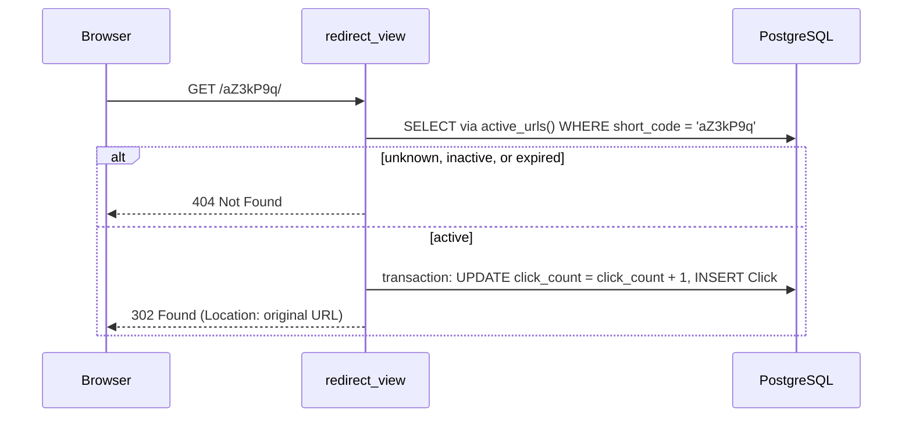
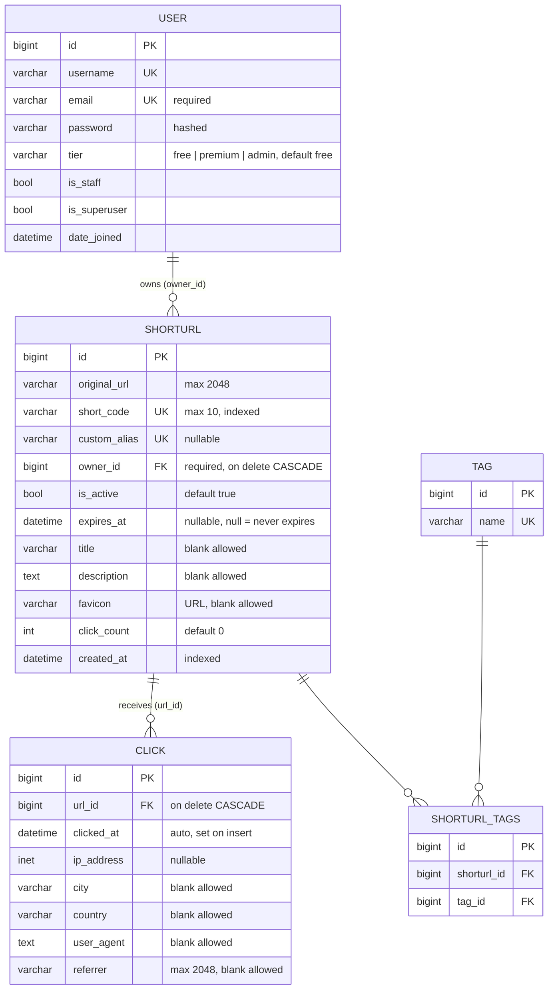

# URL Shortener Microservice

A URL shortener (like Bitly or TinyURL) built with Django and Django REST Framework, running in Docker with PostgreSQL. The project is built progressively over five modules; this README reflects the current state: **Module 6**, which extends the Module 5 foundation with users and ownership, click analytics, tags, custom managers, and query optimization.

## Table of Contents

- [Tech Stack](#tech-stack)
- [Architecture](#architecture)
- [Data Model](#data-model)
- [Data Layer and Query Optimization](#data-layer-and-query-optimization)
- [Project Structure](#project-structure)
- [Setup](#setup)
- [Configuration](#configuration)
- [Development vs Production](#development-vs-production)
- [Authentication](#authentication)
- [API Endpoints](#api-endpoints)
- [Error Format](#error-format)
- [Development Tooling](#development-tooling)
- [Roadmap](#roadmap)

## Tech Stack

| Technology | Role |
|---|---|
| Python 3.12 | Core language |
| Django + Django REST Framework | Web framework and REST API |
| PostgreSQL 16 | Database |
| django-filter | Declarative query-parameter filtering for list endpoints |
| Gunicorn | WSGI application server |
| WhiteNoise | Serves static files (admin styling) |
| drf-spectacular | OpenAPI 3 schema and Swagger UI |
| python-decouple, dj-database-url | Configuration from environment variables |
| Docker + Docker Compose | Containerization |
| pre-commit, Ruff, mypy (django-stubs) | Linting, formatting, and type checking (development only) |

## Architecture

### Redirect flow

The redirect is a plain Django view (it returns a redirect, not JSON), so it stays public. It only follows URLs that are enabled and not expired, and it records each click in one transaction.



### Key design decisions

**Configuration**

- **Configuration from the environment.** Secrets and per-environment values (`SECRET_KEY`, `DEBUG`, `DATABASE_URL`) come from `.env`; nothing sensitive is in the code or the image. Required values have no defaults, so a misconfigured deployment fails at startup instead of running with fake values.
- **Custom user model from the first migration.** `AUTH_USER_MODEL = "accounts.User"` was set before any migration ran, so extending the user in Module 6 only meant adding fields.

**Short codes and redirects**

- **Secure short codes.** 7-character base62 codes generated with Python's `secrets` module, so links can't be guessed (about 3.5 trillion combinations).
- **Collision handling that is race-proof.** The service tries to insert the code and lets the database's UNIQUE constraint report a collision (`IntegrityError`), retrying up to 5 times inside a savepoint. Checking with `exists()` first would leave a race between the check and the insert. If every attempt collides, the API returns a clear `503` instead of failing silently.
- **302 redirects.** Temporary redirects make every click reach the server, which click analytics need (a 301 would be cached by browsers).

**Data layer**

- **`is_premium` is derived from `tier`.** Storing both as separate columns could let them disagree (a Free user with `is_premium=True`). `tier` is the single source of truth and `is_premium` is a property computed from it.
- **`click_count` is a deliberate cache.** The `Click` table is the source of truth; `click_count` duplicates its count so URLs can be sorted by popularity without counting rows. It is updated in one place only, atomically, together with the `Click` insert.
- **Query methods live on a custom QuerySet.** `active_urls()`, `expired_urls()`, and `popular_urls()` are defined on a QuerySet and exposed through `URLManager`, so they chain anywhere: `ShortURL.objects.filter(...).active_urls()` and `user.urls.active_urls()` both work. Django's QuerySet already plays the repository role, so no extra repository layer wraps it.

**API**

- **Ownership enforced in one place.** The ViewSet's `get_queryset()` only returns the requesting user's URLs, which protects list, retrieve, update, and delete at once. Another user's short code returns `404`, not `403`, so the API doesn't reveal that the link exists.
- **Pagination chosen per data shape.** A user's URL list is small, so it uses page numbers with a capped page size. Click history (Module 7 analytics) grows without limit and is append-only, so it will use cursor pagination.
- **Deterministic ordering.** Every ordering gets `-id` appended as a tie-breaker, so pages never repeat or skip rows when sorted by a non-unique field such as `click_count`.
- **Standardized errors.** Every API error uses the same JSON shape (see [Error Format](#error-format)).

## Data Model



`SHORTURL_TAGS` is the join table Django creates automatically for the `ShortURL.tags` many-to-many field; it has no model of its own.

### Field decisions worth noting

| Field | Definition | Why |
|---|---|---|
| `User.email` | `EmailField(unique=True)` | Redeclared to make it required and unique; `AbstractUser` defines it as optional |
| `User.is_premium` | Property, not a column | Derived from `tier` to avoid two sources of truth |
| `ShortURL.short_code` | `unique=True` | The unique constraint creates an index automatically, so a separate `db_index` would be redundant |
| `ShortURL.custom_alias` | `null=True, blank=True, unique=True` | Empty aliases are stored as `NULL`, because Postgres treats NULLs as distinct; empty strings would collide on the unique constraint |
| `ShortURL.owner` | `ForeignKey(..., on_delete=CASCADE, related_name="urls")` | Every URL belongs to a user; deleting a user deletes their URLs; `user.urls` gives the reverse access |
| `ShortURL.expires_at` | `null=True` | `NULL` naturally means "never expires," with no magic far-future date |
| `ShortURL.created_at` | `auto_now_add=True, db_index=True` | Default sort key for lists, so it is indexed |
| `Click.url` | `ForeignKey(..., on_delete=CASCADE, related_name="clicks")` | Clicks are meaningless without their URL; `url.clicks` gives the reverse access |
| `Click.ip_address` | `GenericIPAddressField(null=True)` | Stored as Postgres `inet`; an empty IP must be `NULL` |

### Migrations

All schema changes are managed with Django migrations, committed to the repository, and applied with `migrate`. The data migration `seed_default_tags` creates the default tags (Marketing, Social, Personal, Work). It uses `apps.get_model()` to work against the historical model, `get_or_create()` so it is safe if a tag already exists, and a reverse function so it can be rolled back.

## Data Layer and Query Optimization

### Custom manager

```python
ShortURL.objects.active_urls()  # enabled and not expired
ShortURL.objects.expired_urls()  # expires_at in the past
ShortURL.objects.popular_urls()  # ordered by click_count, then created_at
ShortURL.objects.active_urls().popular_urls()[:10]  # methods chain
request.user.urls.active_urls()  # and work through relationships
```

`active_urls()` uses `Q` objects because "active" needs an OR: enabled **and** (no expiry **or** expiry in the future). `timezone.now()` is evaluated inside each method, never at import time, so "now" is always current.

### N+1 prevention

| Where | Technique | Result |
|---|---|---|
| Admin URL list (shows owner and tags) | `select_related("owner")` + `prefetch_related("tags")` via `with_relations()` | Constant number of queries regardless of rows |
| Admin click list (shows URL) | `list_select_related = ("url",)` | One JOIN instead of one query per row |
| API URL list (shows tags) | `prefetch_related("tags")` | 3 queries per page: count, page of URLs, tags |

The API list does not `select_related("owner")`: the owner is always the requesting user and is not part of the response, so joining it would load unused data. Query counts were verified with `CaptureQueriesContext` by adding rows and checking that the count stays the same.

### Atomic click counting

```python
with transaction.atomic():
    ShortURL.objects.filter(pk=url.pk).update(click_count=F("click_count") + 1)
    Click.objects.create(url=url, ...)
```

`F()` makes Postgres perform the increment on the row itself, so simultaneous clicks are never lost (a Python read-modify-write would let two requests both write the same value). The transaction keeps `click_count` and the `Click` table in agreement.

### Aggregations

Analytics are computed in SQL, not in Python:

```python
url.clicks.aggregate(
    total=Count("id"),
    last_7_days=Count("id", filter=Q(clicked_at__gte=week_ago)),  # conditional aggregation
)
url.clicks.values("country").annotate(clicks=Count("id")).order_by("-clicks")  # GROUP BY country
```

### Indexes

| Column | Index |
|---|---|
| `short_code` | Unique index (from `unique=True`) |
| `custom_alias` | Unique index (from `unique=True`) |
| `created_at` | B-tree index (`db_index=True`) |


## Setup

**Prerequisites:** Docker Desktop and Git.

1. Clone the repository:

   ```bash
   git clone https://github.com/B-Pine/url-shortener.git
   cd url-shortener
   ```

2. Create your environment file from the template:

   ```bash
   cp .env.example .env
   ```

   Generate a secret key and paste it as `SECRET_KEY` in `.env`:

   ```bash
   python -c "from django.core.management.utils import get_random_secret_key; print(get_random_secret_key())"
   ```

   If the key contains a `$`, wrap it in single quotes (`SECRET_KEY='...'`), otherwise Docker Compose treats `$` as the start of a variable. The template's database values work as they are for local development.

3. Build and start the containers:

   ```bash
   docker compose up --build -d
   ```

4. Create the database tables (this also seeds the default tags):

   ```bash
   docker compose exec web python manage.py migrate
   ```

5. Create a user. The API requires authentication, so this step is required:

   ```bash
   docker compose exec web python manage.py createsuperuser
   ```

   To create an ordinary (non-admin) user, for example to test that users can't see each other's URLs:

   ```bash
   docker compose exec -T web python manage.py shell <<'EOF'
   from accounts.models import User
   User.objects.create_user(username="bob", email="bob@example.com", password="bobpass123")
   EOF
   ```

The API is now available at `http://localhost:8000`, and the interactive docs at `http://localhost:8000/api/v1/docs/`.

### Useful commands

```bash
docker compose ps                # show running services
docker compose logs -f web       # follow application logs
docker compose down              # stop containers (data is kept)
docker compose down -v           # stop and delete the database volume
```

### Creating migrations after model changes

In development the project folder is mounted into the container, so migration files created there appear directly in your repository:

```bash
docker compose exec web python manage.py makemigrations
docker compose exec web python manage.py migrate
```

The container runs as a non-root user. If `makemigrations` hits a permission error writing through the bind mount, run it as root: `docker compose exec -u root web python manage.py makemigrations`.

To check that models and migration files agree (useful before committing):

```bash
docker compose exec web python manage.py makemigrations --check --dry-run
```

## Configuration

All settings are read from `.env` (see `.env.example`).

| Variable | Required | Description |
|---|---|---|
| `SECRET_KEY` | Yes | Django secret key; wrap in single quotes if it contains `$` |
| `DEBUG` | No (default `False`) | `True` for development only |
| `ALLOWED_HOSTS` | No (default `localhost,127.0.0.1`) | Comma-separated host names |
| `POSTGRES_DB`, `POSTGRES_USER`, `POSTGRES_PASSWORD` | Yes | Used by the `db` container to create the database |
| `DATABASE_URL` | Yes | Connection string used by Django, e.g. `postgres://user:pass@db:5432/name` |
| `DB_LOG_LEVEL` | No (default `INFO`) | Set to `DEBUG` (with `DEBUG=True`) to log every SQL query, handy for spotting N+1 problems |
| `WEB_CONCURRENCY` | No | Number of Gunicorn workers in production |

Changes to `.env` require recreating the containers (`docker compose down` then `docker compose up -d`); a restart is not enough.

## Development vs Production

| | Development | Production |
|---|---|---|
| Command | `docker compose up -d` | `docker compose -f docker-compose.yml up -d` |
| Code changes | Picked up automatically (bind mount + Gunicorn `--reload`) | Require an image rebuild |
| Gunicorn workers | 1 (with 4 threads) | Set with `WEB_CONCURRENCY` in `.env` |
| `DEBUG` | `True` | `False` |

`docker compose up` automatically merges `docker-compose.override.yml`, which holds the development-only settings. Passing `-f docker-compose.yml` uses only the base file, giving a production-like setup.

The `Dockerfile` is multi-stage: the first stage installs dependencies, and the final image copies only the installed packages and the code, keeping it small. The application runs as a non-root user (`appuser`). Every request is logged to the console with its method, path, status code, and duration (`docker compose logs -f web`).

## Authentication

This module uses Django REST Framework's built-in **Basic** and **Session** authentication; JWT arrives in Module 7. Every `/api/v1/` endpoint requires a logged-in user, while the public redirect and the API docs stay open.

- **curl:** pass credentials with `-u username:password`.
- **Swagger UI:** open `/api/v1/docs/`, click **Authorize**, and enter your username and password under `basicAuth`.
- **Admin:** log in at `/admin/` with a superuser account.

| Situation | Response |
|---|---|
| No credentials | `401 Unauthorized` with a `WWW-Authenticate: Basic` header |
| Another user's short code | `404 Not Found` (the link's existence is not revealed) |

Basic authentication is listed before Session authentication so that unauthenticated requests get a proper `401` (DRF takes the `WWW-Authenticate` header from the first authentication class, and Session authentication has none, which would turn the response into a `403`).

If you are logged into the admin in the same browser, Swagger sends the session cookie too, and Session authentication enforces CSRF protection on `POST`, `PUT`, `PATCH`, and `DELETE`. If you get a `403` mentioning CSRF, log out of the admin or use a private window and authorize with Basic only.

## API Endpoints

| Method | Endpoint | Auth | Description | Success |
|---|---|---|---|---|
| `GET` | `/api/v1/urls/` | Required | List your short URLs (paginated, filterable, sortable) | `200 OK` |
| `POST` | `/api/v1/urls/` | Required | Create a short URL | `201 Created` |
| `GET` | `/api/v1/urls/{short_code}/` | Required | Retrieve one of your URLs | `200 OK` |
| `PUT` | `/api/v1/urls/{short_code}/` | Required | Update one of your URLs | `200 OK` |
| `PATCH` | `/api/v1/urls/{short_code}/` | Required | Partially update one of your URLs | `200 OK` |
| `DELETE` | `/api/v1/urls/{short_code}/` | Required | Delete one of your URLs | `204 No Content` |
| `GET` | `/{short_code}/` | Public | Redirect to the original URL and record the click | `302 Found` |
| `GET` | `/api/v1/` | Required | API root listing the endpoints | `200 OK` |
| `GET` | `/api/v1/docs/` | Public | Interactive Swagger UI | `200 OK` |
| `GET` | `/api/v1/schema/` | Public | OpenAPI 3 schema | `200 OK` |
| `GET` | `/admin/` | Admin login | Django admin | `200 OK` |

### Create a short URL

```bash
curl -i -u admin:yourpassword -X POST http://localhost:8000/api/v1/urls/ \
  -H "Content-Type: application/json" \
  -d '{"original_url": "https://www.djangoproject.com/"}'
```

Response (`201 Created`):

```json
{
  "original_url": "https://www.djangoproject.com/",
  "short_code": "aZ3kP9q",
  "short_url": "http://localhost:8000/aZ3kP9q/",
  "tags": [],
  "is_active": true,
  "expires_at": null,
  "click_count": 0,
  "created_at": "2026-11-14T10:15:00Z"
}
```

The owner is always the authenticated user; it is never read from the request body.

### List your URLs

```bash
curl -u admin:yourpassword "http://localhost:8000/api/v1/urls/?page_size=2&ordering=-click_count"
```

Response (`200 OK`):

```json
{
  "count": 12,
  "next": "http://localhost:8000/api/v1/urls/?ordering=-click_count&page=2&page_size=2",
  "previous": null,
  "results": [
    {
      "original_url": "https://www.djangoproject.com/",
      "short_code": "aZ3kP9q",
      "short_url": "http://localhost:8000/aZ3kP9q/",
      "tags": ["Work"],
      "is_active": true,
      "expires_at": null,
      "click_count": 42,
      "created_at": "2026-11-14T10:15:00Z"
    }
  ]
}
```

#### Query parameters

| Parameter | Example | Description |
|---|---|---|
| `page` | `?page=2` | Page number (20 results per page by default) |
| `page_size` | `?page_size=50` | Results per page, capped at 100 |
| `is_active` | `?is_active=false` | The raw on/off flag |
| `status` | `?status=active` | `active` (enabled and not expired) or `expired` |
| `tag` | `?tag=marketing` | Tag name, case-insensitive |
| `created_after` | `?created_after=2026-11-01T00:00:00Z` | Created on or after this ISO 8601 datetime |
| `created_before` | `?created_before=2026-11-30T23:59:59Z` | Created on or before this ISO 8601 datetime |
| `ordering` | `?ordering=-click_count` | `created_at` or `click_count`; prefix with `-` for descending. Default: `-created_at` |

Parameters combine, for example `?status=active&tag=social&ordering=-click_count`. Invalid values (such as a malformed date) return `400` in the standard error format, and a page past the end returns `404`.

### Update or deactivate a URL

```bash
curl -u admin:yourpassword -X PATCH http://localhost:8000/api/v1/urls/aZ3kP9q/ \
  -H "Content-Type: application/json" \
  -d '{"is_active": false}'
```

Writable fields: `original_url`, `is_active`, `expires_at`. A deactivated or expired URL stops redirecting immediately (`404`), because the redirect only follows `active_urls()`.

### Delete a URL

```bash
curl -i -u admin:yourpassword -X DELETE http://localhost:8000/api/v1/urls/aZ3kP9q/
```

Returns `204 No Content`. The URL's clicks are deleted with it (`on_delete=CASCADE`).

### Redirect

Opening `http://localhost:8000/aZ3kP9q/` returns `302 Found` with a `Location` header pointing to the original URL, and records a `Click` (IP address, user agent, referrer) while incrementing `click_count`. Unknown, inactive, and expired codes return `404 Not Found`.

## Error Format

All API errors share one shape, so clients only handle a single structure:

```json
{
  "status_code": 400,
  "message": "Validation failed.",
  "errors": {
    "original_url": ["Enter a valid URL."]
  }
}
```

For errors that aren't tied to specific fields, `errors` is `null` and `message` describes the problem:

| Status | When |
|---|---|
| `400 Bad Request` | Invalid body or query parameter |
| `401 Unauthorized` | Missing or wrong credentials |
| `404 Not Found` | Unknown short code, another user's URL, or a page past the end |
| `405 Method Not Allowed` | Unsupported HTTP method |
| `503 Service Unavailable` | A unique short code could not be generated after several attempts (retrying is safe) |

## Development Tooling

Code quality checks run automatically before every commit with [pre-commit](https://pre-commit.com/):

| Hook | Checks |
|---|---|
| pre-commit-hooks | Trailing whitespace, final newlines, YAML/TOML syntax, merge conflict markers, private keys, files over 500 KB |
| Ruff | Linting (pyflakes, pycodestyle, import order, bugbear, pyupgrade, Django rules) with auto-fix, and formatting |
| mypy + django-stubs + djangorestframework-stubs | Static type checking with Django and DRF awareness |

Setup (in a local virtual environment):

```bash
pip install -r requirements-dev.txt
pre-commit install            # run the hooks on every commit
pre-commit run --all-files    # run them on the whole project
```

Configuration lives in `pyproject.toml` (Ruff and mypy) and `.pre-commit-config.yaml`. Development tools are kept in `requirements-dev.txt`, separate from `requirements.txt`, so they never end up in the Docker image.

The mypy hook loads Django's settings to understand the models, so its `additional_dependencies` must include every package Django imports at startup: each app in `INSTALLED_APPS`, everything `settings.py` imports, and the PostgreSQL driver (`psycopg` and `psycopg-binary`). When a new app is added to `INSTALLED_APPS`, add it there too.

## Roadmap

- [x] **Module 5:** Project foundation, Docker, REST API, validation, Swagger docs
- [x] **Module 6:** Extended data model (users, clicks, tags), migrations with seeded data, custom managers, query optimization, owner-scoped CRUD with basic authentication
- [ ] **Module 7:** JWT authentication (register, login, refresh), role-based access, tier limits (Free: 10 URLs, no custom alias; Premium: unlimited, custom aliases, analytics), premium analytics endpoint, rate limiting
- [ ] **Module 8:** Redis caching, Celery tasks (async click tracking, expired URL cleanup), structured logging, health checks
- [ ] **Module 9:** URL preview microservice, resilience patterns, CORS
