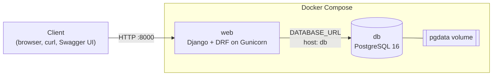
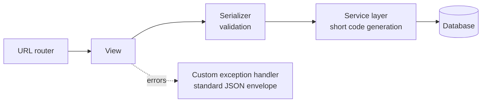

# URL Shortener Microservice

A URL shortener (like Bitly or TinyURL) built with Django and Django REST Framework, running in Docker with PostgreSQL. The project is built progressively over five modules; this README reflects the current state (Module 5: foundation, Docker, REST API, validation, and API docs).

## Tech Stack

| Technology | Role |
|---|---|
| Python 3.12 | Core language |
| Django + Django REST Framework | Web framework and REST API |
| PostgreSQL 16 | Database |
| Gunicorn | WSGI application server |
| WhiteNoise | Serves static files (admin styling) |
| drf-spectacular | OpenAPI 3 schema and Swagger UI |
| python-decouple, dj-database-url | Configuration from environment variables |
| Docker + Docker Compose | Containerization |

## Architecture



Inside the `web` container, a request flows through these layers:



Key design decisions:

- **Configuration from the environment.** Secrets and per-environment values (`SECRET_KEY`, `DEBUG`, `DATABASE_URL`) come from `.env`; nothing sensitive is in the code or the image.
- **Service layer.** Business logic lives in `shortener/services.py`, keeping views thin. The code generator is passed in as a parameter, so it can be swapped in tests.
- **Secure short codes.** 7-character base62 codes generated with Python's `secrets` module, so links can't be guessed.
- **302 redirects.** Temporary redirects make every click reach the server, which click analytics will need later (a 301 would be cached by browsers).
- **Standardized errors.** Every API error uses the same JSON shape (see below).

## Setup

**Prerequisites:** Docker Desktop and Git.

1. Clone the repository:

   ```bash
   git clone https://github.com/B-Pine/url-shortener.git
   cd url-shortener
   ```

2. Create your environment file from the template:

   ```bash
   cp .env.example .env
   ```

   Generate a secret key and paste it as `SECRET_KEY` in `.env`:

   ```bash
   python -c "from django.core.management.utils import get_random_secret_key; print(get_random_secret_key())"
   ```

   The template's database values work as they are for local development.

3. Build and start the containers:

   ```bash
   docker compose up --build -d
   ```

4. Create the database tables:

   ```bash
   docker compose exec web python manage.py migrate
   ```

5. (Optional) Create an admin user:

   ```bash
   docker compose exec web python manage.py createsuperuser
   ```

The API is now available at `http://localhost:8000`.

### Useful commands

```bash
docker compose ps                # show running services
docker compose logs -f web       # follow application logs
docker compose down              # stop containers (data is kept)
docker compose down -v           # stop and delete the database volume
```

### Creating migrations after model changes

In development the project folder is mounted into the container, so migration files created there appear directly in your repository:

```bash
docker compose exec web python manage.py makemigrations
docker compose exec web python manage.py migrate
```

## Development vs Production

| | Development | Production |
|---|---|---|
| Command | `docker compose up -d` | `docker compose -f docker-compose.yml up -d` |
| Code changes | Picked up automatically (bind mount + Gunicorn `--reload`) | Require an image rebuild |
| Gunicorn workers | 1 | Set with `WEB_CONCURRENCY` in `.env` |
| `DEBUG` | `True` | `False` |

`docker compose up` automatically merges `docker-compose.override.yml`, which holds the development-only settings. Passing `-f docker-compose.yml` uses only the base file, giving a production-like setup.

The `Dockerfile` is multi-stage: the first stage installs dependencies, and the final image copies only the installed packages and the code, keeping it small. Every request is logged to the console with its method, path, status code, and duration (`docker compose logs -f web`).

## API Endpoints

| Method | Endpoint | Description | Success |
|---|---|---|---|
| `POST` | `/api/v1/urls/` | Create a short URL | `201 Created` |
| `GET` | `/{short_code}/` | Redirect to the original URL | `302 Found` |
| `GET` | `/api/v1/docs/` | Interactive Swagger UI | `200 OK` |
| `GET` | `/api/v1/schema/` | OpenAPI 3 schema | `200 OK` |
| `GET` | `/admin/` | Django admin | `200 OK` |

### Create a short URL

```bash
curl -i -X POST http://localhost:8000/api/v1/urls/ \
  -H "Content-Type: application/json" \
  -d '{"original_url": "https://www.djangoproject.com/"}'
```

Response (`201 Created`):

```json
{
  "original_url": "https://www.djangoproject.com/",
  "short_code": "aZ3kP9q",
  "short_url": "http://localhost:8000/aZ3kP9q/",
  "created_at": "2026-11-07T10:15:00Z"
}
```

### Redirect

Opening `http://localhost:8000/aZ3kP9q/` returns `302 Found` with a `Location` header pointing to the original URL. Unknown codes return `404 Not Found`.

### Error format

All API errors share one shape, so clients only handle a single structure:

```json
{
  "status_code": 400,
  "message": "Validation failed.",
  "errors": {
    "original_url": ["Enter a valid URL."]
  }
}
```

For errors that aren't tied to specific fields (such as 404 or 405), `errors` is `null` and `message` describes the problem.

## API Documentation

With the containers running, open **http://localhost:8000/api/v1/docs/** to explore and test the API in Swagger UI. The raw OpenAPI schema is at `/api/v1/schema/`.

## Roadmap

- [x] **Module 5:** Project foundation, Docker, REST API, validation, Swagger docs
- [ ] **Module 6:** Extended data model (users, clicks, tags), custom managers, query optimization
- [ ] **Module 7:** JWT authentication, role-based access, tier limits, rate limiting
- [ ] **Module 8:** Redis caching, Celery tasks, structured logging, health checks
- [ ] **Module 9:** URL preview microservice, resilience patterns, CORS
